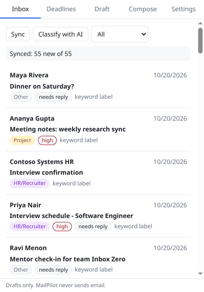

# MailPilot

A Chrome extension and a local Python API that help a student handle email: sort it into categories, pull out deadlines with reminders, draft replies grounded in their own notes (RAG), and write new emails from a one-line instruction.

**MailPilot never sends email.** It only shows text you copy. Every draft passes a guardrail that turns unsupported dates, links and phone numbers into `[confirm: ...]` placeholders.



*The tour shows the popup working against the sample inbox, with labels from the keyword classifier. It was recorded without an LLM key, so it shows no generated draft.*

## Features

| Tab | What it does |
|---|---|
| Inbox | Syncs mail and shows category, priority, needs-reply and replied badges. "Classify with AI" upgrades the instant keyword labels to LLM labels. |
| Deadlines | Scans mail for deadlines (structured LLM extraction; relative dates resolved against the received date). Sorted list, overdue items in red, mark done. The service worker sets `chrome.alarms` reminders 24 h and 2 h before each due time, and the badge counts items due today. |
| Draft | Reply draft for the selected mail: classify, retrieve, generate, guardrails. Editable, shows the sources used, has a copy button and a 1-5 rating. |
| Compose | A new email from an instruction such as "ask HR to reschedule my interview". |
| Settings | Model picker, your own API keys (kept in `chrome.storage.local`), tone, categories, sign-off name, local-only mode, re-index notes. |

## Architecture


- **Backend:** FastAPI, Pydantic and plain `sqlite3`. Mails, deadlines, drafts, feedback, settings and the LLM response cache all live in one SQLite file.
- **Models:** LiteLLM, so one call covers Gemini, Groq, Ollama, OpenAI and Anthropic. The `MODEL` setting picks the default; the popup can override the model and key per request with the `X-Model` and `X-Api-Key` headers. Calls retry with backoff and are cached by `sha256(model + prompt)` so they survive free-tier rate limits.
- **RAG:** `data/context/` (resume, notes, past replies) is split into chunks, embedded locally with `BAAI/bge-small-en-v1.5`, and stored in Chroma. Search is hybrid: Chroma vector results and BM25 results are merged with reciprocal rank fusion. A cross-encoder rerank is optional (`RERANK=true`).
- **Retrieval filters:** chunks are filtered by the mail's category and by sender. A note tagged `contact: x@y.com` is only used when replying to that person, so one thread never leaks into another.
- **Mail sources:** `FileMailSource` (JSON or `.mbox`) and `GmailMailSource` (OAuth installed-app flow, `gmail.readonly`).

Design choices and their reasons are in [DECISIONS.md](DECISIONS.md).

## Setup

You need Python 3.11, Node 20+ and one free model option: a [Gemini key](https://aistudio.google.com/apikey), a [Groq key](https://console.groq.com/keys), or [Ollama](https://ollama.com) with `ollama pull qwen2.5:7b`.

```bash
cp .env.example .env          # add GEMINI_API_KEY or GROQ_API_KEY, or set MODEL=ollama/qwen2.5:7b
```

**Backend with Docker**

```bash
docker compose up --build     # http://localhost:8000/docs
```

**Backend without Docker (dev)**

```bash
cd backend
python3.11 -m venv .venv && .venv/bin/pip install -r requirements.txt
.venv/bin/uvicorn app.main:app --reload
```

The first draft request downloads the embedding model (about 130 MB) and indexes `data/context/`.

**Extension**

```bash
cd extension && npm install && npm run build
```

Then open `chrome://extensions`, turn on Developer mode, click "Load unpacked" and pick `extension/dist`. Open the popup, go to Inbox and press **Sync**.

**Gmail (optional)**

1. In Google Cloud, create an OAuth client of type "Desktop app" and enable the Gmail API. Keep the app in testing mode and add yourself as a test user.
2. Save the client file as `secrets/credentials.json`.
3. Run `cd backend && .venv/bin/python -m app.mail_sources.gmail_source` once. It opens a browser and writes `secrets/token.json`.
4. Set `MAIL_SOURCE=gmail` in `.env`.

**Your own context:** edit or replace the files in `data/context/` (resume, notes, past replies). Each file can start with a `---` header containing `type`, `category` and `contact`. Then press "Re-index my notes" in Settings.

## Tests

CI (GitHub Actions) runs both suites and the extension build on every push.

```bash
cd backend && .venv/bin/pytest -q      # 40 tests: fake LLM and fake embedder, no network
cd extension && npm test               # reminder scheduling, badge count, key routing
```

## Results

All numbers come from `eval/run_eval.py`; see [results/summary.md](results/summary.md) and the CSVs in [results/](results/). The dataset is 55 hand-labeled mails in [data/sample_mails.json](data/sample_mails.json) (11 Placement, 11 HR/Recruiter, 12 Academic, 10 Project, 11 Other; 45 gold deadlines; 17 mails that need a reply) and 18 hand-labeled retrieval queries in [data/retrieval_eval.json](data/retrieval_eval.json).

**Retrieval** (18 queries, relevance labeled per document):

| mode | recall@1 | recall@3 | recall@5 | MRR |
|---|---|---|---|---|
| hybrid (vector + BM25, RRF) | 0.722 | 0.889 | 0.944 | 0.847 |
| vector only (bge-small) | 0.583 | 0.750 | 0.833 | 0.708 |
| BM25 only | 0.806 | 0.972 | 0.972 | 0.944 |

Hybrid search beats vector-only search, but BM25 alone did best on this set. The queries were written by the same person as the notes and share a lot of vocabulary with them, which favors keyword matching. A set of paraphrased queries is the next step before choosing between hybrid and BM25.

**Classification** (55 mails):

| model | accuracy | macro-F1 | needs-reply accuracy |
|---|---|---|---|
| keyword baseline | 0.800 | 0.793 | 0.909 |

**Not run yet:** the LLM classification rows, deadline precision/recall, and RAG vs no-RAG draft quality (on the 17 needs-reply mails, judged by an LLM plus a manual 1-5 rating) all need a model, and none was available on the build machine. To fill them in:

```bash
cd backend
.venv/bin/python ../eval/run_eval.py --models gemini/gemini-2.5-flash groq/llama-3.3-70b-versatile --sleep 4
```

This writes `results/classification.csv`, `deadlines.csv`, `drafts.csv`, `drafts_detail.csv` and a `manual_ratings.csv` template; fill in its `rating` column and re-run to include the manual scores. Only copy numbers into this README from `results/summary.md`.

## Limitations

- The guardrail is regex-based. It catches invented dates, times, weekdays, links, emails and phone numbers, plus a greeting name that does not appear in the mail. It cannot catch an invented commitment written in plain words ("I have already submitted it").
- Date matching in the guardrail is literal: "Thu" in the mail and "Thursday" in the draft is flagged as unsupported. This errs toward false alarms.
- The sample dataset is small, synthetic and written by one person, so all metrics have wide error bars.
- Deadline evidence is checked by word overlap (at least 80% of the quoted words must appear in the mail). A real date with a badly paraphrased quote is dropped.
- Keyword labels are what you see until you press "Classify with AI". This keeps sync free on rate-limited tiers.
- The extension only has host permission for `localhost:8000`. A remote backend needs a manifest change.
- Gmail access is read-only. Creating Gmail drafts (`gmail.compose`) is not implemented.

## Project structure

```
backend/app/       api/ (routers), mail_sources/, llm/ (client, classifier, deadlines, generator, guardrails),
                   rag/ (chunker, store, retriever, ingest), prompts/*.txt, db.py, models.py, config.py, redact.py
backend/tests/     pytest suite
extension/src/     popup/ (App + 5 tabs), background/ (alarms, badge), shared/ (api client, storage, reminders)
data/              sample_mails.json, retrieval_eval.json, context/
eval/              run_eval.py, eval.ipynb
results/           CSVs + summary.md
docs/              architecture.png, ui-tour.gif, screenshots/
```

## License

MIT, see [LICENSE](LICENSE).
