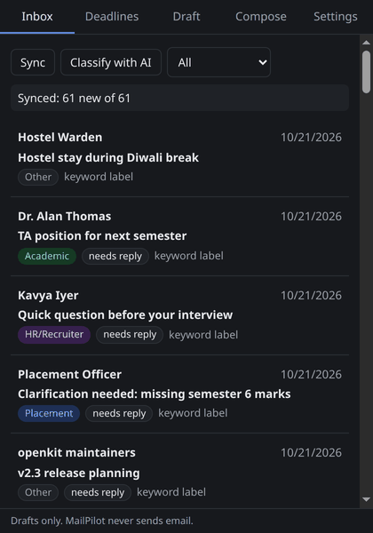
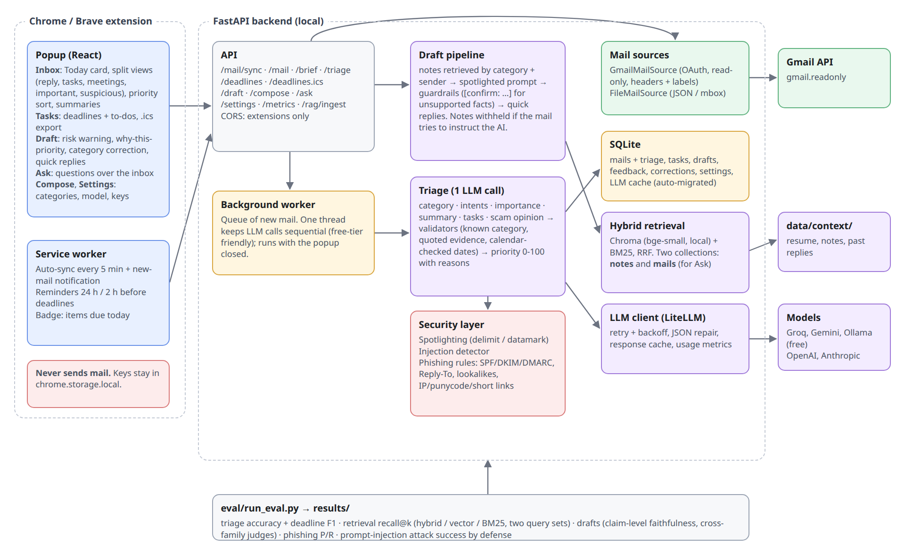

# MailPilot

A Chrome extension and a local Python API that help a student handle email: sort it into categories, pull out deadlines with reminders, draft replies grounded in their own notes (RAG), and write new emails from a one-line instruction.

**MailPilot never sends email.** It only shows text you copy. Every draft passes a guardrail that turns unsupported dates, links and phone numbers into `[confirm: ...]` placeholders.



*Recorded from the real extension and backend with `groq/openai/gpt-oss-120b`, in this order: keyword labels on sync, AI classification, deadline scan, a reply draft grounded in the user's availability notes, its sources, and a new email from a one-line instruction. More frames are in [docs/screenshots/](docs/screenshots/).*

## Features

| Tab | What it does |
|---|---|
| Inbox | Syncs mail automatically every 5 minutes (with a notification for new mail) or on demand, and shows category, priority, needs-reply and replied badges. "Classify with AI" upgrades the instant keyword labels to LLM labels. |
| Deadlines | Scans mail for deadlines (structured LLM extraction; relative dates resolved against the received date). Sorted list, overdue items in red, mark done. The service worker sets `chrome.alarms` reminders 24 h and 2 h before each due time, and the badge counts items due today. |
| Draft | Reply draft for the selected mail: classify, retrieve, generate, guardrails. Editable, shows the sources used, has a copy button and a 1-5 rating. |
| Compose | A new email from an instruction such as "ask HR to reschedule my interview". |
| Settings | Model picker, your own API keys (kept in `chrome.storage.local`), tone, categories, sign-off name, local-only mode, re-index notes. |

## Architecture



- **Backend:** FastAPI, Pydantic and plain `sqlite3`. Mails, deadlines, drafts, feedback, settings and the LLM response cache all live in one SQLite file.
- **Models:** LiteLLM, so one call covers Gemini, Groq, Ollama, OpenAI and Anthropic. The `MODEL` setting picks the default; the popup can override the model and key per request with the `X-Model` and `X-Api-Key` headers. Calls retry with backoff and are cached by `sha256(model + prompt)` so they survive free-tier rate limits.
- **RAG:** `data/context/` (resume, notes, past replies) is split into chunks, embedded locally with `BAAI/bge-small-en-v1.5`, and stored in Chroma. Search is hybrid: Chroma vector results and BM25 results are merged with reciprocal rank fusion. A cross-encoder rerank is optional (`RERANK=true`).
- **Retrieval filters:** chunks are filtered by the mail's category and by sender. A note tagged `contact: x@y.com` is only used when replying to that person, so one thread never leaks into another.
- **Mail sources:** `FileMailSource` (JSON or `.mbox`) and `GmailMailSource` (OAuth installed-app flow, `gmail.readonly`).

Design choices and their reasons are in [DECISIONS.md](DECISIONS.md).

## Setup

You need Python 3.11, Node 20+ and one free model option: a [Groq key](https://console.groq.com/keys) (default), a [Gemini key](https://aistudio.google.com/apikey), or [Ollama](https://ollama.com) with `ollama pull qwen2.5:7b`.

```bash
cp .env.example .env          # add GROQ_API_KEY (or GEMINI_API_KEY, or set MODEL=ollama/qwen2.5:7b)
```

**Backend**

```bash
cd backend
python3.11 -m venv .venv && .venv/bin/pip install -r requirements.txt
.venv/bin/uvicorn app.main:app --reload        # API docs at http://localhost:8000/docs
```

The first draft request downloads the embedding model (about 130 MB) and indexes `data/context/`.

**Extension**

```bash
cd extension && npm install && npm run build
```

Then open `chrome://extensions`, turn on Developer mode, click "Load unpacked" and pick `extension/dist`. Open the popup, go to Inbox and press **Sync**.

**Gmail (optional)**

MailPilot reads Gmail through Google's OAuth flow with the read-only scope. Your password is never used or stored.

1. Go to [console.cloud.google.com](https://console.cloud.google.com), create a project and enable the **Gmail API**.
2. Under **Google Auth Platform → Audience**, keep the app in **Testing** and add your Gmail address as a test user.
3. Under **Clients**, create an OAuth client of type **Desktop app** and download the JSON file. Save it as `secrets/credentials.json`; the `secrets/` folder is gitignored.
4. Run `cd backend && .venv/bin/python -m app.mail_sources.gmail_source` once. It opens a browser to sign in and writes `secrets/token.json`.
5. Set `MAIL_SOURCE=gmail` in `.env`, restart the backend and press **Sync**. The newest 50 inbox mails are loaded.

**Your own context:** edit or replace the files in `data/context/` (resume, notes, past replies). Each file can start with a `---` header containing `type`, `category` and `contact`. Then press "Re-index my notes" in Settings.

## Tests

CI (GitHub Actions) runs both suites and the extension build on every push.

```bash
cd backend && .venv/bin/pytest -q      # 48 tests: fake LLM and fake embedder, no network
cd extension && npm test               # reminder scheduling, badge count, key routing
```

## Results

Every number below comes from `eval/run_eval.py` ([results/summary.md](results/summary.md), CSVs in [results/](results/)). The data is synthetic and hand-labeled: 61 mails in [data/sample_mails.json](data/sample_mails.json) (12 Placement, 13 HR/Recruiter, 13 Academic, 11 Project, 12 Other; 50 gold deadlines; 23 need a reply) and two sets of 18 retrieval queries. All models ran on Groq's free tier.

**Classification** (61 mails)

| model | accuracy | macro-F1 | needs-reply accuracy |
|---|---|---|---|
| keyword baseline | 0.787 | 0.778 | 0.902 |
| gpt-oss-120b (default) | 0.951 | 0.949 | 1.000 |
| gpt-oss-20b | 0.951 | 0.951 | 0.934 |
| qwen3.8-27b | 0.934 | 0.934 | 0.984 |

**Deadline extraction** (a prediction is correct if its date matches a gold date in the same mail)

| prompt | model | precision | recall | F1 |
|---|---|---|---|---|
| v1 | gpt-oss-120b | 0.774 | 0.960 | 0.857 |
| v1 | gpt-oss-20b | 0.758 | 0.940 | 0.839 |
| v1 | qwen3.8-27b | 0.842 | 0.960 | 0.897 |
| v2 | gpt-oss-120b | 0.896 | 0.860 | 0.878 |
| **v3 (current)** | **gpt-oss-120b** | **0.891** | **0.980** | **0.933** |
| v3 | gpt-oss-20b | 0.889 | 0.960 | 0.923 |
| v3 | qwen3.8-27b | 0.920 | 0.920 | 0.920 |

Error analysis of v1 showed two kinds of mistakes:

- **Weekday arithmetic.** "By Sunday", sent on a Monday, was resolved to Saturday. LLMs are known to be weak at this ([Test of Time](https://arxiv.org/abs/2406.09170), Fatemi et al., 2024).
- **Dates that are not deadlines.** These included interview-slot options, "registration opens on…", promo expiries and outage notices.

v2 added a 21-day calendar to the prompt (`Mon 19 Oct 2026`, ...) so the model looks dates up instead of computing them, plus rules for slots, windows and notices. Two of v2's new rules over-corrected: exam periods went to their last day, and preparation steps were dropped. v3 fixed those two rules. v3 improved F1 for all three models. **Caveat:** v2 and v3 were written after looking at errors on this same set, and there is no held-out set, so the v3 numbers are optimistic. Files: [deadlines_prompt_v1.csv](results/deadlines_prompt_v1.csv), [deadlines_prompt_v2.csv](results/deadlines_prompt_v2.csv), [deadlines.csv](results/deadlines.csv).

**Retrieval** (doc-level recall@k: share of a query's relevant notes in the top k chunks)

| query set | mode | recall@1 | recall@3 | recall@5 | MRR |
|---|---|---|---|---|---|
| original wording | hybrid (vector + BM25, RRF) | 0.722 | 0.889 | 0.944 | 0.847 |
| original wording | vector only (bge-small) | 0.583 | 0.750 | 0.833 | 0.708 |
| original wording | BM25 only | 0.806 | 0.972 | 0.972 | 0.944 |
| paraphrased | hybrid | **0.500** | **0.694** | **0.833** | **0.676** |
| paraphrased | vector only | 0.472 | 0.556 | 0.694 | 0.588 |
| paraphrased | BM25 only | 0.306 | 0.528 | 0.694 | 0.502 |

The first query set shares vocabulary with the notes, so BM25 wins there. With paraphrased queries ("move cities" instead of "relocate"), BM25 drops sharply and hybrid is best at every k. That is why hybrid is the default.

**Reply drafts: with notes (RAG) vs without**

Drafts were written by gpt-oss-120b and graded automatically, following published LLM-as-judge practice, with no hand-picked scores:

- **Claim-level faithfulness.** The judge lists every factual claim in the draft and marks whether the mail or notes support it ([RAGAS](https://arxiv.org/abs/2309.15217), Es et al., EACL 2024; [FActScore](https://arxiv.org/abs/2305.14251), Min et al., EMNLP 2023).
- **Rubric helpfulness (1-5)**, with a written description for each level ([G-Eval](https://arxiv.org/abs/2303.16634), Liu et al., EMNLP 2023).
- **A main judge from a different model family** (Qwen) than the writer (gpt-oss), because LLM judges favor their own outputs ([Panickssery et al., NeurIPS 2024](https://arxiv.org/abs/2404.13076)).
- **Pairwise preference asked in both orders.** A win only counts if it survives the swap, which cancels position bias ([Zheng et al., NeurIPS 2023](https://arxiv.org/abs/2306.05685)).
- **A second judge** (gpt-oss-20b) on a subset, as a check on the first.

| judge | condition | drafts | faithfulness | unsupported claims / draft | helpfulness (1-5) |
|---|---|---|---|---|---|
| qwen3.8-27b (main) | RAG | 22 | **0.823** | **0.77** | **4.14** |
| qwen3.8-27b (main) | no RAG | 23 | 0.691 | 1.13 | 3.57 |
| gpt-oss-20b (check) | RAG | 15 | 0.656 | 1.40 | 4.53 |
| gpt-oss-20b (check) | no RAG | 13 | 0.660 | 1.31 | 4.38 |

Pairwise, judged by Qwen in both orders on all 23 mails: **RAG won 11, no-RAG won 4**, and 8 were ties or flipped with the order.

**How much to trust this:**

- The main judge covers all 23 needs-reply mails (one RAG grade failed). The second judge covers 28 drafts from the first 17 mails, because the free tier's daily token limit (200k per model) ran out.
- The two judges agree weakly on faithfulness (Spearman 0.38) and moderately on helpfulness (0.55).
- Reading the disagreements showed why. Qwen sometimes listed `[placeholders]` as unsupported claims; these are now excluded from scoring. gpt-oss-20b counted pleasantries such as "I really enjoyed my internship" as unsupported facts, which penalizes the RAG drafts because they say more.
- The fair summary: the main, cross-family judge clearly prefers the RAG drafts on both faithfulness and helpfulness, and pairwise it picks RAG almost 3 to 1. The second judge sees no faithfulness difference but also rates RAG more helpful. With 23 synthetic mails, this is a signal, not proof.

LLM responses are cached in SQLite, so re-running `eval/run_eval.py` reproduces these tables without new API calls.

## Limitations

- The guardrail is regex-based. It catches invented dates, times, weekdays, links, emails and phone numbers, plus a greeting name that does not appear in the mail. It cannot catch an invented commitment written in plain words ("I have already submitted it").
- Date matching in the guardrail is literal: "Thu" in the mail and "Thursday" in the draft is flagged as unsupported. This errs toward false alarms.
- The sample dataset is small, synthetic and written by one person, so all metrics have wide error bars. The deadline prompt was tuned on the same data it is scored on.
- Groq's free tier allows 200k tokens per model per day, and reasoning models (gpt-oss) spend many tokens thinking. A full eval from scratch needs about two days of free quota; the SQLite cache makes resuming free.
- Deadline evidence is checked by word overlap (at least 80% of the quoted words must appear in the mail). A real date with a badly paraphrased quote is dropped.
- Keyword labels are what you see until you press "Classify with AI". This keeps sync free on rate-limited tiers.
- The extension only has host permission for `localhost:8000`. A remote backend needs a manifest change.
- Gmail access is read-only and was tested only with parsed sample messages, not a live account. Creating Gmail drafts (`gmail.compose`) is not implemented.

## Project structure

```
backend/app/       api/ (routers), mail_sources/, llm/ (client, classifier, deadlines, generator, guardrails),
                   rag/ (chunker, store, retriever, ingest), prompts/*.txt, db.py, models.py, config.py, redact.py
backend/tests/     pytest suite
extension/src/     popup/ (App + 5 tabs), background/ (alarms, badge), shared/ (api client, storage, reminders)
data/              sample_mails.json, retrieval_eval.json, retrieval_eval_paraphrased.json, context/
eval/              run_eval.py, metrics.py, eval.ipynb
results/           CSVs + summary.md
docs/              architecture.png, demo.gif, screenshots/
```

## License

MIT, see [LICENSE](LICENSE).
